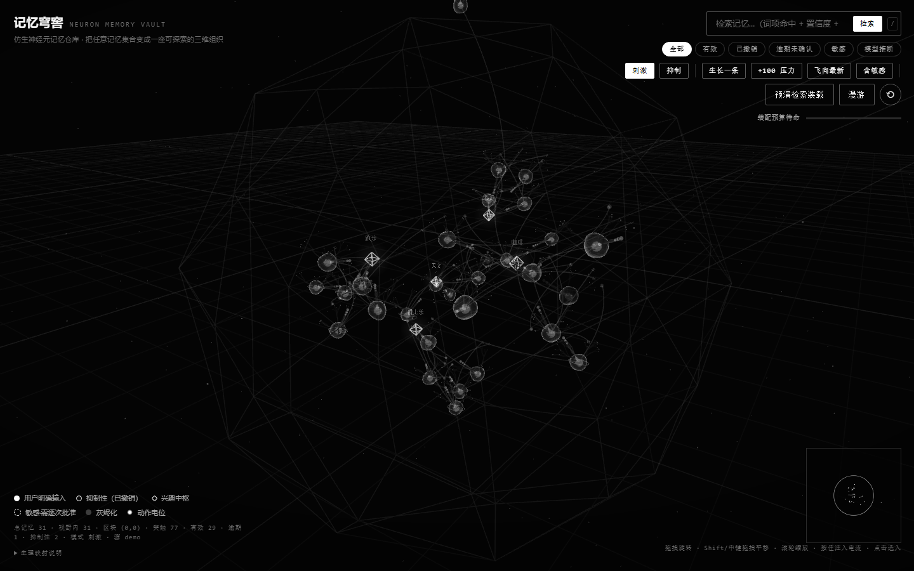
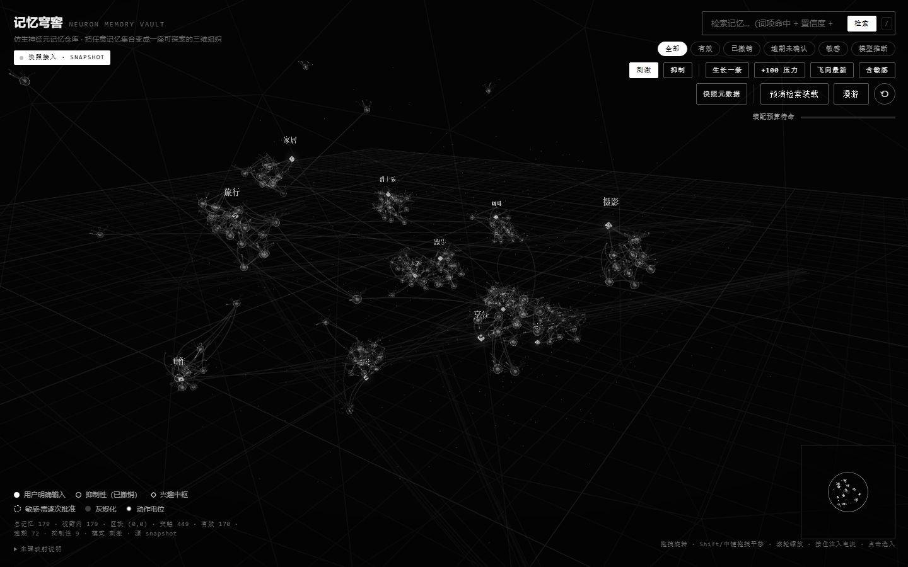

# 记忆穹窖 · Neuron Memory Vault

> 把一份记忆集合，变成一座会呼吸的仿生神经组织。
> Turn a memory collection into a living piece of bionic neural tissue.



**单文件 · 零依赖 · 零网络请求 · 双击即用**
**Single file · zero dependencies · zero network requests · just double-click**

---

## 这是什么 · What is this

**中文**：记忆穹窖把你的记忆数据渲染成一片三维神经组织——每条记忆是一个解剖结构完整的神经元（胞体、树突棘、轴突、髓鞘、突触），兴趣聚集成核团，空间分布按神经组织的统计特征生成。它不是「节点连线图」：动画全部由膜电位驱动，发放必须被生理规则赢得；静息时组织是安静的，只有被激活的神经元才有反应。查记忆、装配记忆、看记忆生长，都在这片组织里发生。

**English**: Neuron Memory Vault renders a memory collection as a 3D piece of neural tissue — every memory is a fully-structured neuron (soma, dendritic spines, axon, myelin, synapses), interests cluster into nuclei, and the spatial layout follows the statistics of real neural tissue. This is not a node-graph: all animation is driven by membrane potential, spikes must be earned through physiology, and the tissue is silent at rest — only activated neurons respond. Searching, assembling and growing memories all happen inside the tissue.

## 两个入口 · Two builds

| 文件 File | 内容 Content |
| --- | --- |
| `memory-vault.html` | 演示版：31 条内置记忆 / 5 个兴趣区，展示全部结构与规则 · Demo with 31 built-in memories across 5 interests |
| `memory-vault-sample.html` | 示例快照：179 条合成记忆 / 12 个兴趣，预演大规模观感 · Sample snapshot with 179 synthetic memories across 12 interests |



## 快速开始 · Quick start

双击任一 HTML 文件即可。无需服务器、无需 npm、无需联网；three.js（r91）已内联。
Double-click either HTML file. No server, no npm, no network; three.js (r91) is inlined.

要求 Requirement: Chrome / Edge / Firefox（支持 WebGL）。禁用硬件加速时页面会给出明确提示而非空白。
If hardware acceleration is disabled the page shows an explicit notice instead of a blank screen.

## 接入你自己的数据 · Plug in your own data

穹窖只认一种输入：**记忆快照 JSON**。把你的数据源（数据库、笔记导出、任意 API）映射成下面的格式，就完成了接入。
The vault consumes one thing: a **memory snapshot JSON**. Map your source — a database, an export, any API — into this format and you are done.

两种方式 Two ways:

1. 编辑 `snapshot/sample-snapshot.json` 换成你的数据，运行 `node tools/build.mjs` 重新生成单文件。
   Replace `snapshot/sample-snapshot.json` with your data and run `node tools/build.mjs`.
2. 在模板副本里注入 `<script>window.MEMORY_SNAPSHOT = {…你的 JSON…}</script>` 后自行合并。
   Or inject `<script>window.MEMORY_SNAPSHOT = {…your JSON…}</script>` into a copy of the template yourself.

### 快照格式 · Snapshot format

```jsonc
{
  "snapshot_version": "memory.snapshot.v1",
  "generated_at": "2026-01-01T00:00:00Z",
  "note": "任意说明文字 · free-form note",
  "counts": { "memories": 179, "active": 170, "retracted": 9,
               "sensitive": 15, "stale": 72, "interests": 12 },
  "memories": [{
    "id": "mem-0001",
    "topic": "astro",                  // 对应 interests[].id · matches interests[].id
    "text": "记忆正文 · memory text",
    "source_category": "user | inferred | turn",
    "confidence": 75,                   // 0–100，决定胞体大小 · soma size
    "status": "active | retracted",     // retracted = 抑制性神经元 · inhibitory neuron
    "sensitivity": "normal | personal | sensitive",
    "revision": 3,
    "changes": ["created", "corrected", "confirmed"],
    "created_days_ago": 103,
    "confirmed_days_ago": 96,
    "message_refs": ["msg-6136"],
    "raw_text_stored": false
  }],
  "interests": [{
    "id": "int-astro", "label": "天文 · Astronomy", "status": "active",
    "evidence_count": 17, "conversation_count": 4,
    "strength": 1, "confidence": 80, "last_seen_days_ago": 16, "terms": ["…"]
  }],
  "events": [{
    "id": "evt-00001", "occurred_at_hours_ago": 2,
    "source_module": "memory", "event_type": "memory.created", "subject_id": "mem-0082"
  }]
}
```

所有字段都有生理含义：`confidence` 决定胞体大小，`status: retracted` 把神经元变成抑制性中间神经元（撤销不是消失，是抑制），`sensitivity: sensitive` 默认脱敏并需要逐会话批准。
Every field carries meaning: `confidence` scales the soma, `status: retracted` turns the neuron into an inhibitory interneuron (revocation is inhibition, not deletion), and `sensitivity: sensitive` is redacted until explicitly approved for the session.

## 特性 · Features

### 解剖结构 · Anatomy
膜电位充电时核仁发光；发放时线粒体加速漂移（代谢响应）；每个神经元 8+ 个树突棘、4 个线粒体、3 段髓鞘、轴突丘与突触扣。
The nucleolus glows while membrane potential charges; mitochondria drift faster after a spike (metabolic response); each neuron has 8+ dendritic spines, 4 mitochondria, 3 myelin segments, an axon hillock and boutons.

### 生理规则 · Physiology
V ∈ [−0.4, 1.25]，阈值 1 → 全或无发放；0.9s 不应期；疲劳累积；囊泡释放 → 下游 PSP；相连双元近同时发放触发赫布增强（LTP）；突触疲劳防止无限互燃。
V ∈ [−0.4, 1.25], threshold 1 → all-or-nothing spike; 0.9s refractory period; fatigue; vesicle release → postsynaptic PSP; near-coincident firing of linked pairs triggers Hebbian potentiation; synaptic depression prevents runaway reverberation.

### 信号是因果的 · Causal signaling
静息 = 静止（200 帧实测 92% 无事件）；单点刺激只点燃 1 个神经元，脉冲数恰好等于其突触数，约 30 帧清空；多条传出按强度依次延后 ~55ms；单突触 EPSP 不足以点火，需要 3–4 个输入时空总和。
Rest = silence (92% of 200 measured frames carry no event); one stimulation ignites exactly one neuron, with as many pulses as its synapses, clearing in ~30 frames; outputs fire staggered by strength (~55 ms apart); a single EPSP cannot trigger a spike — 3–4 inputs must sum.

### 组织学布局 · Histological layout
兴趣中枢由 Poisson 盘不规则采样；每区 1–3 个亚核（高斯散布 + 各向异性）；6% 孤立细胞散在区间；2 个类脑室空腔；2 束白质样纤维穿过组织；连接以局部 kNN 为主 + 7% 长投射（重尾）。
Nuclei are sampled by Poisson-disc (no symmetry); each has 1–3 sub-cores (Gaussian scatter + anisotropy); 6% isolated cells live between clusters; 2 ventricle-like voids; 2 white-matter-like fiber tracts; connectivity is local kNN + 7% long-range projections (heavy tail).

| 指标 Metric（179 条 · 12 区） | 实测 Value |
| --- | --- |
| 中枢间距变异系数 Nucleus spacing CV | 0.33 |
| 最近邻距离均值 Mean nearest-neighbor | 2.45（中位 median 1.7，最大 max 19.1） |
| 连接边长中位 / 最长 Edge length median / max | 1.77 / 52 |

### 无限画布 · Infinite canvas
区块网格 + 细网格随相机移动；按距离剔除（大集合只画近处）；黄金角不再使用——新记忆从同类宿主芽生；右下角小地图；1440px 与 390px 均无横向溢出。
Chunk grid + fine grid follow the camera; distance culling keeps large collections cheap; new memories bud from same-topic hosts; minimap bottom-right; no horizontal overflow at 1440px or 390px.

### 隐私 · Privacy
`敏感` 级记忆默认以 ▮▮▮▮▮▮ 显示，需要逐会话批准才进入搜索与装配——数据在页面里，不发给任何服务器（本项目根本没有服务器）。
`sensitive` memories are shown as ▮▮▮▮▮▮ by default and require per-session approval before entering search or assembly — data stays in the page and is sent nowhere (there is no server).

## 交互速查 · Interactions

| 操作 Action | 效果 Effect |
| --- | --- |
| 拖拽 Drag | 旋转视角 Orbit |
| 滚轮 Wheel | 缩放 Zoom |
| Shift/右键拖拽 Shift/right-drag | 平移 Pan |
| 点击神经元 Click neuron | 详情与膜电位 Details & membrane readout |
| 按住神经元 Hold neuron | 注入电流（刺激/抑制模式 Inject in excite/inhibit mode） |
| 顶部搜索 Top search | 词项命中 + 置信度加权 Term hits + confidence weighting |
| 合额感 Assemble | 按预算 3000 字符装配一段记忆 · Assemble within a 3000-char budget |

## 设计原则 · Design principles

1. **仿生不是装饰**：任何动画都必须由膜电位赢得，没有时间驱动的「背景动画」。
   Bionic means earned: no time-driven ambient animation — everything is driven by membrane potential.
2. **撤销不是消失**：被撤销的记忆变成抑制性神经元，还在组织里施加 IPSP。
   Revocation is inhibition: retracted memories remain as inhibitory neurons applying IPSPs.
3. **诚实的数据**：没有记忆就显示空旷的组织，绝不伪造热闹。
   Honest data: an empty vault looks empty — no fake liveliness.

## 从源码构建 · Build from source

```bash
node tools/build.mjs
# → memory-vault.html + memory-vault-sample.html
```

模板在 `src/memory-vault.template.html`（`/*__THREE_JS__*/` 与 `/*__SNAPSHOT__*/` 两个占位符），three.js r91 在 `vendor/`。
Template at `src/memory-vault.template.html` (placeholders `/*__THREE_JS__*/` and `/*__SNAPSHOT__*/`), three.js r91 in `vendor/`.

## 兼容性 · Compatibility

Chrome / Edge / Firefox 现代版本；`file://` 协议可用（ES 模块已规避）；手机端 390px 宽度无横向滚动。
Modern Chrome / Edge / Firefox; works over `file://` (no ES modules); mobile-friendly at 390px with no horizontal scroll.

## License

[MIT](LICENSE)
